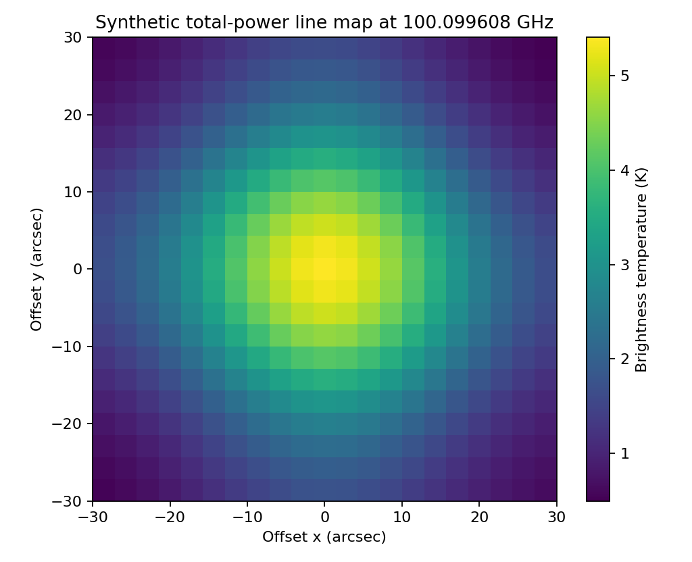

# ALMA single-dish and spectrometer lab

[](https://github.com/pkd-45/alma-sd-spectrometer-lab/actions/workflows/ci.yml)

An independent, compact software demonstrator prepared for the NAOJ **Senior Specialist, ALMA Project** vacancy. It targets **either JD1 or JD2**, with the strongest immediate fit to JD1.

> **Scope:** synthetic data and simulated devices only. This repository is not affiliated with ALMA/NAOJ, does not use proprietary ALMA code or data, and is not presented as production telescope software.

## What it demonstrates

### JD1 - single-dish processing

- Python package and command-line interface on Linux/macOS;
- deterministic synthetic ON/OFF total-power raster observations;
- position-switch calibration;
- robust channel flagging;
- line-masked polynomial baseline subtraction;
- spectral regridding and spatial cube gridding;
- process-based parallel scan processing and a Slurm recipe;
- scientific QA and SHA-256 product provenance.

### JD2 - spectrometer software

- simulated ADC voltages and accumulated FFT power spectra;
- explicit OFF/READY/ARMED/ACQUIRING/FAULT state machine;
- structured JSONL telemetry, fault injection and recovery;
- NumPy CPU and optional CuPy GPU backends;
- standalone C++17 radix-2 FFT reference with CTest;
- written software requirements, design and validation plans.

The single-dish stages are intentionally concept-aligned with public CASA/ALMA processing ideas such as calibration, baseline fitting and total-power imaging, without reimplementing or claiming compatibility with CASA operational tasks.



## Quick start

```bash
python3 -m venv .venv
source .venv/bin/activate
python -m pip install --upgrade pip
python -m pip install -e '.[dev]'

ruff check .
mypy src/alma_lab
pytest

python -m alma_lab spectrometer --output products/spectrometer
python -m alma_lab demo --workers 2 --output products/demo
python scripts/make_quicklook.py
```

## C++ reference

```bash
cmake -S cpp -B cpp/build -DCMAKE_BUILD_TYPE=Release
cmake --build cpp/build --parallel 2
ctest --test-dir cpp/build --output-on-failure
./cpp/build/alma_fft_reference --self-test
```

## GPU benchmark

Install the optional CuPy dependency for the CUDA version available on the target machine, then run:

```bash
python scripts/benchmark_fft.py --backend cupy --repeats 10
```

The repository reports measured timings; it does not claim GPU performance without executing on a GPU.

## Scientific gates

The end-to-end demo refuses to publish a product unless it recovers the injected line frequency within 2 MHz, exceeds peak S/N 10, and produces a cube with at least 99% finite voxels.

## Documents

- [Software requirements](docs/SOFTWARE_REQUIREMENTS_SPECIFICATION.md)
- [Design](docs/DESIGN.md)
- [Verification and validation](docs/VERIFICATION_AND_VALIDATION.md)
- [Vacancy mapping](docs/APPLICATION_MAPPING.md)
- [Public Hector evidence and safe wording](docs/HECTOR_PUBLIC_EVIDENCE.md)

## Official context

- NAOJ vacancy: Senior Specialists, ALMA Project, JD1/JD2.
- ALMA Science Portal: CASA and the ALMA pipeline are used for calibration and imaging of interferometric and single-dish data.
- CASAdocs: public single-dish tasks include calibration, spectral baseline fitting and total-power imaging.
